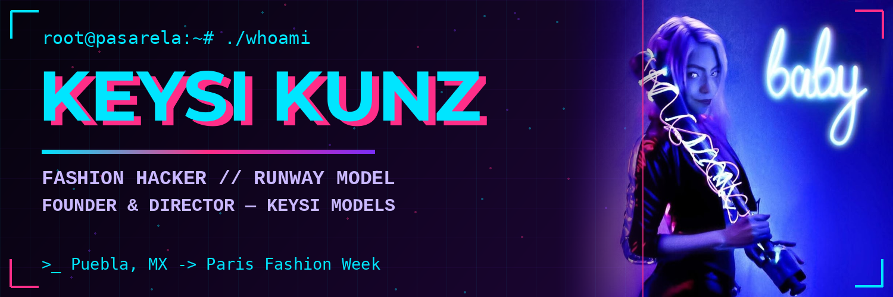

# Keysi Kunz

- Hi there 👋 I'm Keysi — fashion designer, elite runway model, and founder of **Keysi Models** 👑
- [![LinkedIn][linkedin-shield]][linkedin-url] [![Website][website-shield]][website-url] [![Instagram Brand][igbrand-shield]][igbrand-url] [![Instagram Accessories][igacc-shield]][igacc-url]
- 😄 Pronouns: she / her
- 📫 How to reach me: through my [website](https://keysi-kunz.github.io/keysi.github.io/) or LinkedIn — bookings open 📩

<table>
<tr>
<td valign="top" width="300">

</td>
<td valign="top">

```console
keysi@fashion-os:~$ neofetch

OS: Puebla, MX -> the world
Host: Keysi Models (est. 2023)
Kernel: Paris Fashion Week 2024 · 2025
Uptime: Designing since 2022
Shell: Runway / Editorial / Commercial
DE: Foil & Epee — fencing
WM: Pole Dance Performer & Instructor
CPU: TROZMER — Fashion Design & Direction '25
GPU: Hand Embroidery RTX ✨

status: [ ACCESS GRANTED ]
```

</td>
</tr>
</table>

- Keysi Kunz's GitHub Stats


## 🔭 I'm currently working on ...

* Keysi Models — model agency: direction, training & bookings (Puebla, MX)
* Keysi Kunz — my own clothing brand & hand-embroidered accessories line
* Runway & editorial bookings as a model — México and international

## 🌱 I'm currently learning ...

* Digital marketing & social media (Google Skillshop · HubSpot Academy)
* Meta Blueprint — taking my agency's marketing pro
* Fashion business (Bocconi · Politecnico di Milano)

## 👯 I'm looking to collaborate on ...

* Fashion editorials, runway shows & brand campaigns
* Designers, photographers & creatives who love a good plot twist

## 💬 Ask me about ...

* Fashion design & hand embroidery
* Runway walking & model coaching
* Fencing — foil & épée (national medalist, btw 🤺)
* Pole dance performance & classes

## ⭐️ Notable Projects and Contributions ...

* [keysi.github.io](https://github.com/keysi-kunz/keysi.github.io) — my professional site, styled like a fashion show
* Paris Fashion Week — co-creator & model: Florentina Leitner (2024) · Vautrait (2025)
* Nuit des Musées, Paris — presented at Palais Galliera (2026)

## ⚡ Fun fact: I fence with the same precision I sew with. Both leave a mark.

```yaml
- name: "Keysi Kunz, about me:"
  hosts: puebla, paris, runway
  become: yes
  vars:
    main_roles:
      "Founder & Director": Keysi Models, since 2023
      "Fashion Designer": Keysi Kunz brand, since 2022
    check_me_on:
      "web": https://keysi-kunz.github.io/keysi.github.io/
      "linkedin": https://www.linkedin.com/in/keysi-kunz
      "instagram_brand": "@key_si_kunz"
      "instagram_accessories": "@keyss.accesorios"
  tasks:
    - name: 'Current status'
      include_role:
        name: Elite_Runway_Model
        tasks_from: ParisFashionWeek.yml
    - name: 'Abstract'
      set_fact:
        abstract: >-
          Hacking the fashion matrix one runway at a time 👠
          Designer by degree, medalist by discipline,
          performer by night. Never stop creating.
    - name: 'Display skills'
      debug:
        msg: "✅ access granted"
      loop:
        - Fashion Design + Hand Embroidery 🧵
        - Runway Direction + Model Coaching 👠
        - Fencing — Foil & Épée 🤺 (National medalist 2015 · 2016 · 2019)
        - Pole Dance — Performer & Instructor 💫
        - Social Media & Content Strategy 📱
```

[linkedin-url]: https://www.linkedin.com/in/keysi-kunz
[linkedin-shield]: https://img.shields.io/badge/-LinkedIn-black.svg?style=for-the-badge&logo=linkedin&colorB=7b2ff7
[website-url]: https://keysi-kunz.github.io/keysi.github.io/
[website-shield]: https://img.shields.io/badge/-Website-black.svg?style=for-the-badge&logo=googlechrome&colorB=00e5ff
[igbrand-url]: https://www.instagram.com/key_si_kunz
[igbrand-shield]: https://img.shields.io/badge/-@key_si_kunz-black.svg?style=for-the-badge&logo=instagram&colorB=ff2e88
[igacc-url]: https://www.instagram.com/keyss.accesorios
[igacc-shield]: https://img.shields.io/badge/-@keyss.accesorios-black.svg?style=for-the-badge&logo=instagram&colorB=b537f2

<!--
**keysi-kunz/keysi-kunz** is a ✨ _special_ ✨ repository because its `README.md` (this file) appears on your GitHub profile.
-->
